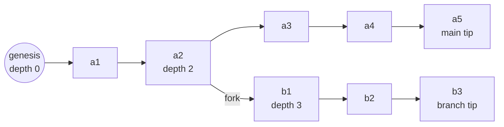

# The DAG

Events form a directed acyclic graph where each event has at most one predecessor. A branch is a path through the graph, not a container of events.

`b1` has `prev = a2`, `branch = b-7f3a2c`, and `depth = 3`. Branch `main` is unchanged by the fork. No event is copied, no file is rewritten, and the fork costs one append of a few hundred bytes.

# Fork is append-only

The fork command appends a single `branch.created` event. It carries the new branch id, the parent branch, the fork event id, and an optional label. Its `prev` is the fork event and its `depth` is one past that event's depth. Nothing else is needed, which is why a fork costs a few hundred bytes rather than a copy.

The parent branch receives no event. That is deliberate. A fork that wrote to its parent would make reading the parent's history depend on how many children it has, and would let an experiment disturb the timeline it branched from.

The branch tree is therefore a global projection. Every `branch.created` event in the store contributes an edge, so the tree is rebuilt from a scan, and a single branch's reader sees only its own path.

# Branch ids

A branch id is `b-` followed by 12 lowercase base32 characters produced by the `Entropy` port. The port makes ids deterministic in tests.

The branch id is stable, short, and independent of the label. A rename appends `dev.mokmok.agent.branch.labeled` on the branch, so the history of names is visible and the id never changes, because events reference it.

# Choosing the fork point

`agentctl fork` accepts one of three selectors.

| Selector | Meaning |
|---|---|
| `--at <event-id>` | Fork from that exact event. |
| `--rewind <n>` | Fork from the tip minus `n` events. |
| `--turn <turn-id>` | Fork from the start of that turn, so the turn runs again. |

Default is the tip, which produces a branch with no events of its own. Default fork point for a retry is the start of the last turn.

Three guards apply.

1. If the fork point is inside a turn, the new branch inherits messages only up to the last completed one. A partially streamed assistant message is not part of the prompt.
2. If the fork point has an intent event with no matching result, the effect may or may not have happened. The command warns and requires `--force`. The warning names the intent so the operator can check the effect.
3. If the fork point sits inside a prompt segment, the fork still works, but the cache advantage shrinks. See [prompt cache](prompt-cache.md) for why, and `--boundary` to snap to the nearest segment boundary.

# Why branches never merge

Merging two timelines requires resolving facts that disagree. In an agent runtime those facts are usually external effects. One branch sent the email and the other did not. A merge has to decide which effect stands, and no rule in the log can decide that, because both effects already happened outside the machine.

Three consequences were weighed.

- A merge node makes the fold a join over a partial order. Every event type would need a resolution rule, and the rules would be guesswork for exactly the cases that matter.
- The value of branching here is divergence, not convergence. Experiments want to run in parallel and produce one winner.
- Copying a winner forward is simple and honest. `agentctl promote` emits selected events onto the target branch as new events with a `promoted_from` field. The target's history stays a single chain.

Promote is out of scope for the first release. The point of recording it here is that the absence of merge is a decision, not an oversight.

# What the reactor does with many branches

- Each active branch is a scheduling unit. The reactor keeps at most `max_active_branches` (default 64) branches with pending work and round-robins them.
- A branch with no pending work costs nothing. It is a tip pointer and a folded state.
- A branch that fails repeatedly is parked with a persisted backoff, so a crash loop does not reset the timer.
- Archived branches are skipped by the scheduler and still readable by every surface.

# Interaction with the surfaces

- The TUI shows the branch tree with depth, label, tip time, unread markers, and last error.
- The WebUI renders one branch per route, with a fork control that takes a turn or an event.
- A chat thread maps to a branch. A fork in chat creates a thread, and the thread id is stored in the branch label so the mapping survives a restart.

# Invariants

1. A fork appends exactly one event and modifies no existing byte.
2. `depth` of the first event on a child branch equals the depth of the fork event plus one.
3. Every event's `prev` resolves. A missing predecessor that was never archived is corruption, not a gap.
4. Tips are derived. Deleting `tips.json` changes nothing except startup scan time.
5. A branch has exactly one tip. Two events with the same branch and depth is a store error and fails verification.
