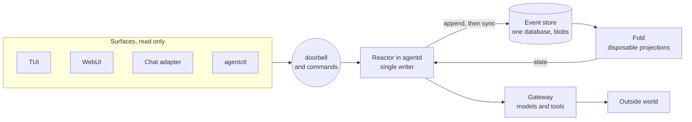

# The shape

The system has one durable artifact and four things that orbit it.

Layers, starting with the store.

**Store.** One database of events, content-addressed and hash chained, with append-only enforced in the schema. It is the only truth. See [event store](event-store.md).

**Fold.** A pure function from an ordered event slice to derived state. It computes branch tips, transcripts, task state, and the token ledger.

**Reactor.** One loop in `agentd`. It reads new events, advances timers, decides one action, and appends. All decisions are pure functions of folded state plus a clock reading.

**Gateway.** Adapters for the outside world. Model providers, tool execution, notifications. Every call is bracketed by intent and result events. See [model gateway](model-gateway.md) and [tools and effects](tools-and-effects.md).

**Surfaces.** Read-only views plus a command channel. See [UI surfaces](../interfaces/ui-surfaces.md).

# Crate map

| Crate | Holds | IO |
|---|---|---|
| `agent-core` | Types, event taxonomy, fold, decision functions, ports | none |
| `agent-store` | Schema, append-only triggers, chain verification, snapshots, backup, blobs | files |
| `agent-prompt` | Canonical prompt rendering, segment hashing, prefix chain | none |
| `agent-model` | Provider adapters over the model port | network |
| `agent-tools` | Tool registry, executors, sandbox policy | processes, network |
| `agent-ipc` | Length-prefixed command protocol over a Unix socket | socket |
| `agent-runtime` | Reactor, timers, scheduler, backpressure, service notification | time, socket |
| `agentd` | Binary that wires runtime to store and gateway | all |
| `agentctl` | Operator CLI, including fork and replay | socket, files |
| `agent-tui` | Terminal surface | socket |
| `agent-web` | HTTP and SSE surface | socket |
| `agent-chat-discord` | Discord surface | socket, network |
| `xtask` | Repo tasks, including the spec validator and mutation driver | files |

# The dependency rule

Dependencies point one way, toward `agent-core`.

- `agent-core` depends on serialization and hashing crates, nothing else.
- Every adapter depends on `agent-core` and on its own driver crate.
- `agent-core` depends on no adapter. It reaches the world through traits declared in `agent-core` and implemented elsewhere.

The traits are narrow on purpose. `Clock` returns an instant. `Entropy` fills bytes. `ModelPort` takes a rendered request and returns a stream. `ToolPort` takes an intent and returns a result. `Notifier` sends a heartbeat.

This rule exists for one reason. Mutation testing at 100 percent killed is only reachable when every branch of logic can be driven from a test without a network, a real clock, or a temp file. A single branch that needs a live provider cannot be mutated, so the rule keeps the logic surface free of such branches.

# What is disposable

Tips, branch lists, transcripts, token totals, and snapshots. Delete any of them and the system rebuilds them by folding the log. Two consequences follow.

- Recovery is the same code path as normal start, so it is exercised on every boot rather than only after a crash.
- A projection bug is a display bug, never data loss.

# What is not disposable

The database and the blobs. They are the only files whose loss is unrecoverable.

# Read path

A surface does not ask `agentd` for state. It opens the store read-only, folds the projection it needs, and re-reads when the database change counter moves. `agentd` is notified of commands over a Unix socket, and notifies surfaces of new data over the same socket with a small `appended` message that carries the new depth. The socket is a doorbell, not a message bus.

This keeps read load off the writer. It also means a surface can never corrupt the log, because it never has a writable handle.

# Write path

Only `agentd` appends. It holds an exclusive lock on the store. It appends in the order the reactor decided, one transaction per batch, and commits before it reports success to itself.

A command from a surface does not write. It becomes a `command.received` event, and the reactor reacts to that event like any other. This is what makes every operator action part of the replayable history.

# Failure posture

The process either makes durable progress or stops. There is no in-memory fallback, no best-effort write, and no automatic state repair that is not itself recorded as an event. The degradation ladder in [runtime](runtime.md) lists what each failure costs and which ones are survivable.
