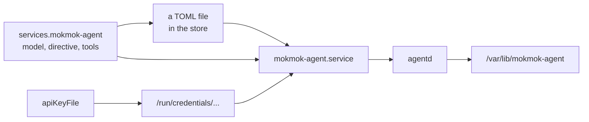

# One module

The flake exports `nixosModules.default`. Enabling it in a configuration is the whole installation.



The module does four things.

- It writes the configuration file into the store. The daemon reads it and never writes it, so a store path is the right home and a rebuild is the right way to change it.
- It creates a system user and group, and a state directory owned by them, mode 0700.
- It hands the API key to the service through systemd's credential directory, when a key file is named. Nothing else on the machine can read that path.
- It sets the unit, including the settings in [Runtime](../architecture/runtime.md) that carry weight.

# What the operator writes

- The model id and the provider's base URL. The daemon appends the endpoint path itself.
- The directive, which is the first bytes of every request, so it must not contain a clock reading or a host name.
- The tool schemas, if any.
- The key, by naming a file or an environment variable, never by value.

An enabled configuration with no model, or with a key named twice, fails evaluation rather than starting a broken service.

# Ordering against the secrets unit

systemd resolves `LoadCredential` when the service starts, so a key that another
unit writes has to exist by then. A secret manager that installs its files at
boot, agenix and sops-nix among them, needs one line in the host configuration:
make the agent start after that unit.

Without it the first start after a reboot fails with a missing credential file,
the supervisor restarts, and the second attempt succeeds because the file has
arrived. The failure looks intermittent, which is the worst way for it to look.

# The operator's command

`services.mokmok-agent.enable = true;` puts `agentctl` on the host as well as the
daemon. A service nobody can send a command to is a service that only ever runs what
it was built with, so the tool arrives with it rather than as a second thing to
remember.

```
agentctl status
agentctl send --branch <id> "what time is it"
agentctl approve <call id>
```

`nix build` at the flake root gives one directory with both binaries in it. The
packages are `.#agentd` and `.#agentctl` when they are wanted separately.

# What is checked and what is not

The flake's check evaluates a configuration, reads the unit text systemd would receive, and asserts the settings this design depends on: the notify type, the watchdog interval, the disabled start rate limit, the state directory, the credential, and the two hardening directives that keep the binary and the home directory read-only.

It also builds the daemon the unit points at, so a unit naming a package that does not compile cannot pass.

Not checked: that the unit actually starts. That needs a virtual machine, which this sandbox cannot run. Between the evaluation check and an operator's first start there is one gap, and it is named here rather than hidden.
